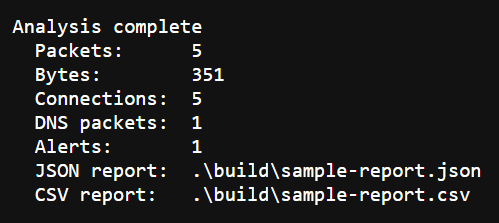
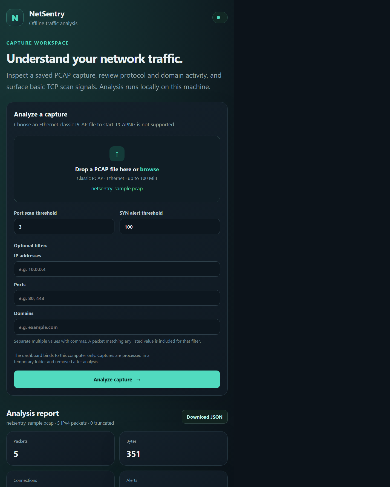

# NetSentry

**NetSentry — Intelligent Network Traffic Analysis & Threat Detection System** is a C++17 offline analyzer for classic Ethernet PCAP captures, with a Python-powered local dashboard. It parses supported IPv4 traffic, summarizes flows and protocols, applies filters, reports visible domain metadata, and flags basic TCP SYN patterns. Reports are available as JSON and CSV.

NetSentry analyzes saved captures only. It does not capture live traffic, block packets, or change network settings.

## Implemented and tested

| Capability | Status | Validation |
|---|---|---|
| Classic PCAP 2.4 reader, including little/big endian and micro/nanosecond timestamps | Implemented | PCAP reader unit test and generated-capture CLI integration test |
| Ethernet II, common VLAN tags, IPv4, TCP, UDP, DNS question parsing | Implemented | Parser unit tests and generated sample |
| HTTP `Host` and TLS ClientHello SNI from a single packet payload | Implemented with limitations | HTTP Host and TLS SNI unit tests |
| Bidirectional TCP/UDP five-tuple flow counts | Implemented | Flow tracking unit test |
| IP, port, domain filters; TCP SYN scan and SYN threshold heuristics | Implemented | Domain filter and detection threshold tests |
| Bounded `std::thread` parser workers, synchronized aggregation, graceful queue drain | Implemented | Queue shutdown test and two-worker CLI integration test |
| CSV and JSON reports | Implemented | Report writer unit and CLI integration tests |
| Local browser dashboard bound to `127.0.0.1:8000` | Implemented | Manual local browser/HTTP smoke test; same analyzer CLI is used |
| Linux CI | Configured | GitHub Actions workflow; hosted run requires pushing to GitHub |
| Windows CI | Configured | GitHub Actions workflow; hosted run requires pushing to GitHub |

These are educational analysis heuristics. They are not a calibrated intrusion detection product.

## Architecture

```text
                         ┌─────────────────────────────────────┐
                         │ Local dashboard (optional)          │
                         │ Python HTTP server, 127.0.0.1:8000  │
                         └──────────────────┬──────────────────┘
                                            │ temporary PCAP / JSON
                                            ▼
Classic PCAP ──► PCAP reader ──► bounded queue ──► C++ parser workers
                                                      │
                           Ethernet/VLAN/IPv4 ─────────┤
                           TCP/UDP/DNS ────────────────┤
                           HTTP Host / TLS SNI ────────┘
                                                      ▼
                                   synchronized filters and analysis
                                   ├─ bidirectional five-tuple flows
                                   ├─ traffic and domain statistics
                                   └─ cumulative TCP SYN heuristics
                                                      ▼
                                     JSON/CSV reports ──► CLI / dashboard
```

The CLI can read a PCAP directly and write reports. The optional dashboard uploads a selected capture to its local-only Python server, which invokes the same CLI in a temporary directory and returns its JSON report. Temporary uploads are deleted after analysis.

## Technologies

- C++17 and the C++ standard library (`std::thread`, mutexes, condition variables)
- CMake 3.16 or later; CTest
- Python 3 for synthetic test-PCAP generation, CLI integration tests, and the optional local dashboard
- Classic PCAP file reading is implemented directly; no libpcap/Npcap dependency or live capture is used
- GitHub Actions for Windows/Linux configure, build, and test jobs

## Project layout

```text
NetSentry/
├── .github/workflows/ci.yml       # Windows/Linux CI
├── docs/screenshots/              # Real local CLI output screenshot
├── include/netsentry/             # Public types and component headers
├── src/                            # C++ parser, analyzer, reports, CLI
├── tests/                          # C++ unit tests and CLI integration test
├── tools/generate_test_pcap.py    # Synthetic, non-sensitive sample PCAP generator
├── web/index.html                  # Local browser dashboard
├── web/server.py                   # Local-only dashboard backend
├── CMakeLists.txt
├── LICENSE
├── README.md
└── WINDOWS_SETUP.md
```

## Prerequisites

- A C++17 compiler: Visual Studio 2022 C++ tools on Windows, or GCC/Clang on Linux
- CMake 3.16+
- Python 3 (recommended; needed for the sample generator, CLI integration test, and dashboard)
- A browser for the optional dashboard

The core analyzer has no third-party C++ library dependency. PCAP files must be classic PCAP with Ethernet link type.

## Build and test

### Windows: Visual Studio Code and CMake

1. Install Visual Studio 2022 or Build Tools with **Desktop development with C++** and a Windows SDK.
2. Install CMake and VS Code. The VS Code CMake Tools extension is optional but recommended.
3. Open the NetSentry folder in VS Code, select a Visual Studio 2022 x64 kit, or use Developer PowerShell in this directory:

   ```powershell
   cmake -S . -B build -G "Visual Studio 17 2022" -A x64 -DBUILD_TESTING=ON
   cmake --build build --config Release --parallel
   ctest --test-dir build -C Release --output-on-failure
   ```

The multi-configuration Visual Studio generator places the executable at `build\Release\netsentry.exe`.

### Linux

On Debian/Ubuntu, install the tools with `sudo apt install build-essential cmake python3`. Then:

```sh
cmake -S . -B build -DCMAKE_BUILD_TYPE=Release -DBUILD_TESTING=ON
cmake --build build --parallel
ctest --test-dir build --output-on-failure
```

The executable is `build/netsentry`.

## Run the command-line analyzer

Generate a harmless local example capture:

```sh
python tools/generate_test_pcap.py build/netsentry_sample.pcap
```

Windows:

```powershell
.\build\Release\netsentry.exe --input .\build\netsentry_sample.pcap --output .\build\sample-report --threads 2 --scan-threshold 3 --syn-threshold 100
```

Linux:

```sh
./build/netsentry --input build/netsentry_sample.pcap --output build/sample-report --threads 2 --scan-threshold 3 --syn-threshold 100
```

The generator creates five synthetic Ethernet/IPv4 packets: one DNS query, one HTTP request, and three TCP SYN packets to different ports. It contains no real network capture data. The command writes `sample-report.json` and `sample-report.csv`; choose one with `--format json` or `--format csv`.

Example from a verified local run:

```text
Analysis complete
  Packets:      5
  Bytes:        351
  Connections:  5
  DNS packets:  1
  Alerts:       1
  JSON report:  .\build\sample-report.json
  CSV report:   .\build\sample-report.csv
```

The report contains 4 TCP packets, 1 UDP packet, `www.example.com` observed twice, and a `port_scan` alert after the configured three distinct SYN destination ports.



The optional dashboard was also exercised locally by uploading the same generated capture:



### CLI options

```text
netsentry --input <capture.pcap> [options]
```

| Option | Meaning |
|---|---|
| `-i, --input PATH` | Required classic PCAP input |
| `-o, --output PREFIX` | Output report prefix (default `netsentry-report`) |
| `--format both\|json\|csv` | Report selection (default `both`) |
| `--threads N` | Parser workers, from 1 to 64 (default up to 8) |
| `--ip IPv4` | Include packets matching either endpoint; repeatable |
| `--port N` | Include packets matching either endpoint port; repeatable |
| `--domain NAME` | Include packets with a matching parsed DNS/HTTP/TLS name; repeatable |
| `--scan-threshold N` | Distinct TCP SYN destination ports per source before one alert (default 20; `0` disables) |
| `--syn-threshold N` | Unacknowledged TCP SYN count per destination before one alert (default 100; `0` disables) |
| `-h, --help` | Show help |

Filters select which packets contribute to statistics and detections; they do not block traffic.

## Run the local dashboard

Build the executable first. From the project root:

```powershell
python .\web\server.py
```

Open [http://127.0.0.1:8000](http://127.0.0.1:8000), select an authorized classic Ethernet PCAP, and choose **Analyze capture**. The browser UI supports the same IP, port, domain, and detection threshold options and can download the JSON report. Stop the server with `Ctrl+C`.

The server binds only to the loopback address `127.0.0.1`, accepts uploads up to 100 MiB, enforces an analysis timeout, and processes uploads in a temporary directory. The capture is sent to the local server process over HTTP; do not expose this development dashboard to an untrusted network or use it for sensitive captures on a shared machine.

## Testing

```sh
ctest --test-dir build --output-on-failure
```

The C++ tests cover HTTP Host, TLS SNI, DNS question parsing, truncated frames and PCAP records, filtering, flow tracking, alert thresholds, queue shutdown, and CSV/JSON generation. The Python CLI integration test generates a synthetic PCAP, runs the actual executable with two workers, and checks its output. CMake registers that integration test when Python 3 is available.

## Limitations

- Only classic PCAP 2.4 with Ethernet link type is accepted; PCAPNG, IPv6, and other link layers are unsupported.
- TCP stream reassembly is not implemented. HTTP Host and TLS SNI extraction works only if the relevant request or complete ClientHello is present in one captured packet. Encrypted ClientHello and encrypted application data cannot be inspected.
- Non-initial IPv4 fragments are not transport-parsed. Truncated records are handled safely and reported, but incomplete transport payloads may not expose application metadata.
- Scan and SYN alerts use cumulative-per-capture counts, not time windows, rates, host reputation, or adaptive thresholds. They can produce false positives or miss activity.
- Domain filtering sees only names parsed from that same packet; DNS-to-flow correlation is not implemented.
- Dashboard test coverage is currently a manual localhost smoke check; automated CTest exercises the underlying CLI rather than browser interactions.
- No benchmark or performance improvement is claimed.

## Future improvements (planned, not implemented)

- Add automated dashboard HTTP/UI tests and dashboard screenshots.
- Add carefully bounded TCP stream reassembly and DNS-to-flow correlation.
- Add IPv6 and PCAPNG support.
- Evaluate time-windowed detection with documented fixtures and configurable policy.
- Consider optional libpcap/Npcap live capture as a separately configured feature.

## Attribution and license

The general project concept was inspired by [perryvegehan/Packet_analyzer](https://github.com/perryvegehan/Packet_analyzer). Its repository had no license at inspection time; this project does not copy its source or documentation and does not claim that project's code as original work.

The independently authored NetSentry contributions are licensed under the [MIT License](LICENSE), added after the project owner confirmed authority to license those contributions. The license does not grant rights to any third-party material.
